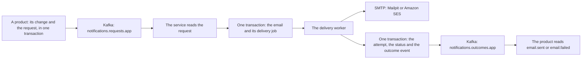

# notifications

The notifications service of the zigordev platform. Every product sends its email through it: a product sends a request event over Kafka, the service delivers the email over SMTP, retries what can still succeed, and answers with an outcome event, sent or failed. toolkit's [record 0042](https://github.com/zigordev/toolkit/blob/main/docs/adr/0042-notifications-takes-requests-and-gives-outcomes-over-kafka.md) holds that decision.

The repo was made on 2026-11-25 from the API half of [toolkit](https://github.com/zigordev/toolkit)'s product template, step 5.1 of the Build plan. Step 5.2 replaced the template's example feature with the service, carried over from November's code: the queue, SMTP delivery, the outcomes and retries, and the deletion of message bodies after 30 days.

## What it is

| Path                            | What it holds                                                                                                                                                                              |
| ------------------------------- | ------------------------------------------------------------------------------------------------------------------------------------------------------------------------------------------ |
| `apps/notifications-api`        | The service: a Fastify app on `@zigordev/api` that reads requests from Kafka, delivers them, and answers each one. Its producers in `producers.json`, its flags in `flags.json`, its image |
| `packages/notifications-events` | `@zigordev/notifications-events`: the request event, the two outcome events and the names of their topics, which the service and every product share                                       |
| `compose.yaml`                  | The whole product as it runs everywhere: the service, its migrate job and its PostgreSQL, each with its limits and health check                                                            |
| `compose.local.yaml`            | What differs on the laptop: the image is built here, mail goes to Mailpit, Kafka takes a throwaway password, and PostgreSQL answers on `127.0.0.1:5435`                                    |
| `compose.production.yaml`       | What differs in production: the address, mail through Amazon SES, and that the deploy runs the migrate job itself                                                                          |
| `compose.test.ts`               | The test that holds the three compose files and the Dockerfile to the container rules                                                                                                      |
| `.env.production.example`       | The names of the secrets that production needs. Only the names: the values live in AWS Parameter Store                                                                                     |
| `.github/workflows/ci.yml`      | The repo's caller: the pipeline on every pull request, then Publish on every merge to `main`                                                                                               |
| `docs/`                         | How to start it on a clean laptop, how it reaches production, how a product sends email, and the decisions about this repo                                                                 |

Its product name is `notifications`, so its app is `notifications-api`. An app has one name, in its folder, its package, its compose service, its image, its telemetry and its Kafka user.

## Why it exists

One service delivers the email of every product, to Mailpit on the laptop and through Amazon SES in production. Delivery, retries, limits and the mail credentials then live in one place, with one log of every email. toolkit's [record 0019](https://github.com/zigordev/toolkit/blob/main/docs/adr/0019-email-through-the-notifications-service.md) chose the service, and record 0042 moved its requests and answers to Kafka, so a product keeps working while the service or the broker is down: its requests wait in its own outbox, then in Kafka.

It is also the first real service through the whole pipeline, so it proves the service half of the platform. [Record 0001](docs/adr/0001-notifications-starts-from-the-api-half-of-the-template.md) says why it starts from the template.

## How it works



1. **A product sends a request.** It renders its email with `@zigordev/email` and writes an `email.requested` event into its own outbox with `@zigordev/events`, in the transaction of its own change. Its relay sends the event to its request topic, `notifications.requests.<app>`.
2. **The service accepts it once.** It reads every producer's request topic as its own Kafka user. In one transaction it stores the email and queues its delivery job in pg-boss, in its own PostgreSQL. The request's id is the email's key: a request that arrives twice is accepted once, and sent once. A sender that the product may not use fails at once.
3. **The worker delivers it.** It sends the email over SMTP, and records every attempt with its outcome. A reply of 4xx is tried again after a pause that grows, five times in all. A reply of 5xx fails at once. A provider that cannot be reached pauses all delivery and counts no attempt, and `/health` answers `degraded` until it answers again.
4. **The service answers.** When the email is sent, or has failed for good, the service writes `email.sent` or `email.failed` into its own outbox, in the same transaction as the email's new status, and its relay sends it to the product's outcome topic, `notifications.outcomes.<app>`. The outcome names the request, never the address.
5. **The bodies go after 30 days.** Every day at 03:17 UTC, a job deletes the HTML and the text of every email that was sent or failed more than 30 days before. The trail of the email and of every attempt stays.

[The user manual](docs/user-manual.md) shows a product's side, with code. Records [0002](docs/adr/0002-requests-and-outcomes-travel-on-topics-named-after-the-service.md), [0003](docs/adr/0003-delivery-carries-over-novembers-smtp-path-outcomes-and-retries.md) and [0004](docs/adr/0004-bodies-are-deleted-30-days-after-an-email-ends.md) hold the decisions.

## What it is built with

| Tool               | What it does here                                                                                                        |
| ------------------ | ------------------------------------------------------------------------------------------------------------------------ |
| Node.js 26         | Runs the service. Its TypeScript files run directly, with no build step                                                  |
| Fastify 5          | Serves the health route and the OpenAPI pages. Products send no HTTP request to it                                       |
| `@zigordev/events` | Reads the requests from Kafka and sends the outcomes through the service's outbox, with retries, dead letters and traces |
| Apache Kafka 4     | The platform's broker, which `platform` runs. Each app signs in as its own user, with SCRAM-SHA-512                      |
| pg-boss            | The delivery queue, its retries and its dead letters, and the daily retention job, inside the service's own PostgreSQL   |
| nodemailer         | Sends each email over SMTP: to Mailpit on the laptop and in the tests, to Amazon SES in production                       |
| `@zigordev/config` | Reads the settings from the environment once, and stops the service when one is wrong                                    |
| `@zigordev/otel`   | The traces, metrics and log lines, and the answer of the health route                                                    |
| `@zigordev/api`    | The base: the error format, the OpenAPI pages, the database and the stop                                                 |
| `@zigordev/flags`  | The feature flags, read from `flags.json` through OpenFeature, with no flag server                                       |
| PostgreSQL 18      | The service's database, in a container of its own on a network of its own                                                |
| Drizzle            | The queries, and with drizzle-kit the SQL of each migration                                                              |
| `@zigordev/test`   | A real PostgreSQL and a real Kafka for the tests. Testcontainers starts Mailpit beside them                              |
| Vitest 5           | Tests every path against real PostgreSQL, Kafka and Mailpit, the service once as a real process, and the compose files   |

The `@zigordev/*` packages come from npm, at the version that `pnpm-workspace.yaml` pins. Renovate proposes each new version.

## Quick start

It needs Docker. From the repo's folder:

```bash
pnpm install
```

```bash
pnpm check
```

`pnpm check` runs what CI runs: lint, build, type check, and every test with coverage. The tests start their own PostgreSQL, Kafka and Mailpit in containers, so nothing else has to run.

To run the product in containers, behind the shared services of `@zigordev/stack`:

```bash
pnpm local:up
```

| Address                                      | Answers                                                                                          |
| -------------------------------------------- | ------------------------------------------------------------------------------------------------ |
| `http://notifications.localhost/health`      | The service's health: its version, and whether its database, flags, mail server and Kafka are up |
| `http://notifications.localhost/api/v1/docs` | The OpenAPI pages, which hold no business route                                                  |
| `http://mail.localhost`                      | Mailpit, with every email the service sent on this laptop                                        |
| `http://grafana.localhost`                   | Grafana. The dashboard named App, in the folder zigordev, lists `notifications-api`              |

Until the broker is in `@zigordev/stack`, the service runs with Kafka down: `/health` answers `degraded`, and no request arrives. The tests use a broker of their own. `pnpm local:down` stops the product and leaves the shared services running. [The local guide](docs/local-first-start.md) has every step, and `pnpm dev api` for hot reload.

## The settings

| Variable                           | Read by          | What it holds                                                                   | When it is not set       |
| ---------------------------------- | ---------------- | ------------------------------------------------------------------------------- | ------------------------ |
| `OTEL_SERVICE_NAME`                | The API, the job | The app's one name                                                              | The app does not start   |
| `OTEL_SERVICE_VERSION`             | The API, the job | The version that runs, shown in its logs, traces and metrics                    | It is left out           |
| `LOG_LEVEL`                        | The API, the job | `debug`, `info`, `warn` or `error`                                              | `info`                   |
| `PORT`, `HOST`                     | The API          | Where it listens                                                                | 3000, on every address   |
| `DATABASE_URL`                     | The API, the job | The address of the app's database, as its own role                              | The app does not start   |
| `DATABASE_ADMIN_URL`               | The job          | The superuser's address, to make the app's role and database                    | The job only migrates    |
| `KAFKA_BROKERS`                    | The API          | The brokers, as `host:port`, separated by commas                                | The API does not start   |
| `KAFKA_USERNAME`, `KAFKA_PASSWORD` | The API          | Its Kafka user, `notifications-api`, and its password                           | The API does not start   |
| `SMTP_HOST`, `SMTP_PORT`           | The API          | The mail server                                                                 | The API does not start   |
| `SMTP_SECURITY`                    | The API          | `starttls`, `tls` or `none`                                                     | `starttls`               |
| `SMTP_USER`, `SMTP_PASSWORD`       | The API          | The sign-in of the mail server, both or neither                                 | No sign-in               |
| `PRODUCERS_FILE`                   | The API          | The path of the list of apps that may send email, with the senders each may use | Its own `producers.json` |
| `FLAGS_FILE`                       | The API          | The path of its flags file                                                      | Its own `flags.json`     |
| `DELIVERY_RETRY_DELAY_SECONDS`     | The API          | The first pause before a deferred email is tried again                          | 30                       |
| `DELIVERY_RETRY_DELAY_MAX_SECONDS` | The API          | The longest pause                                                               | 300                      |
| `PROVIDER_CHECK_INTERVAL_SECONDS`  | The API          | How often it asks the mail server whether it is up                              | 30                       |
| `EMAIL_BODY_RETENTION_DAYS`        | The API          | How long the bodies of a finished email are kept                                | 30                       |

The compose files set every one that a container needs. The service reads nothing but environment variables and its two files.

## The data

The service keeps its state in its own PostgreSQL, `notifications-postgres`, as the role `notifications_api`. On the laptop it answers at `127.0.0.1:5435`, beside the template's on 5433 and the playground's on 5434.

| Table            | Holds                                                                                                                |
| ---------------- | -------------------------------------------------------------------------------------------------------------------- |
| `emails`         | One row per request: the producer, the request's id, the addresses, the subject, the bodies, the tags and the status |
| `email_attempts` | One row per try: its outcome, the SMTP code, the provider's message id and how long it took                          |
| `events_outbox`  | The outcome events waiting for the relay, from `@zigordev/events`                                                    |
| `events_handled` | The ids of the requests already read, kept 30 days, from `@zigordev/events`                                          |
| `pgboss.*`       | pg-boss's own schema: the queues `email-deliveries`, `email-dead-letters` and `email-retention`, and the schedule    |

Before the service starts, the one-shot job `notifications-api-migrate` makes the role and the database when they are missing, applies the migrations in `apps/notifications-api/drizzle/`, then installs pg-boss's schema, its three queues and the daily schedule. The service starts pg-boss without changing its schema, and refuses to start when a queue is missing. A change to the tables is a migration: `pnpm --dir apps/notifications-api run db:generate --name <change>` writes its SQL, and the `add-migration` skill holds the steps.

## What it reports

Nothing personal reaches a log line, a metric or a span: no address, no subject, no body. Log lines name the email's id, the request's id and the producer.

| Log event                | Level | Means                                                                     |
| ------------------------ | ----- | ------------------------------------------------------------------------- |
| `email.accepted`         | info  | A request was stored and its delivery queued                              |
| `email.replayed`         | info  | A request arrived again, and was not stored twice                         |
| `email.sender_forbidden` | warn  | A request named a sender its product may not use, and failed at once      |
| `email.sent`             | info  | The mail server took the email                                            |
| `email.retry_scheduled`  | warn  | A deferred attempt, which will be tried again                             |
| `email.dead_lettered`    | error | The email failed for good, with its reason                                |
| `email.delivery_failed`  | error | A delivery threw. Its job is tried again                                  |
| `provider.unavailable`   | error | The mail server cannot be reached or refuses the sign-in. Delivery pauses |
| `provider.recovered`     | info  | The mail server answers again. Delivery goes on                           |
| `email.bodies_deleted`   | info  | The daily job deleted old bodies, with their count                        |
| `email.retention_failed` | error | The daily job failed. pg-boss tries it again                              |
| `queue.failed`           | error | pg-boss reported an error                                                 |

| Metric                                  | Labels            | Counts                                                             |
| --------------------------------------- | ----------------- | ------------------------------------------------------------------ |
| `notifications.email.accepts`           | producer, outcome | Requests read: `created`, `replayed` or `forbidden`                |
| `notifications.email.sends`             | producer, outcome | Attempts: `sent`, `deferred`, `rejected` or `provider_unavailable` |
| `notifications.email.deliveries`        | producer, outcome | Emails that ended: `sent` or `failed`                              |
| `notifications.email.delivery.duration` | producer          | Seconds from the request to the mail server taking it              |

`@zigordev/events` adds the messaging metrics of the requests and the outcomes, and pg-boss those of its queues. One trace follows a request from the product's send, through the service's consumer, the queue and the SMTP send, to the outcome's send. An idle service starts no trace.

## How it runs in containers

`compose.yaml` describes each service once, and the other two files hold only what differs. The service runs as the user `node`, on a read-only file system, with no capability, under 256 MiB and one CPU, behind a health check that also fails while `/tmp/drain` exists, so a deploy drains it first. The database's image is pinned by its digest, and the tests run the same one. The image carries `producers.json` and `flags.json`, so a change to either goes live with the deploy of its merge.

`pnpm check:contract` builds the image and holds it, and the compose files, to the twelve promises of [the platform page](https://github.com/zigordev/toolkit/blob/main/docs/handbook/the-platform.md). The pipeline runs it on every pull request.

## How it reaches production

On a merge to `main`, Publish builds `ghcr.io/zigordev/notifications-api` for arm64 and attests it, and Release tags the next version and publishes `@zigordev/notifications-events` to npm when a merge's title gives one: a `feat` gives a minor version, a `fix` a patch. There is no Deploy job yet: it comes with step 5.5, once `platform` has the broker on the host, the SES identity, the deploy target and the secrets. [How it reaches production](docs/cloud-first-deploy.md) lists what each of them needs.

## What is left for later

- **In `platform`:** the broker in the local bundle and on the host, with the service's Kafka user, each app's topics and their access rules. Then step 5.4: the SES identity for the domain, the mail password and the deploy role.
- **Step 5.5, production:** the Deploy job, and a real email sent from a merge with no manual step.
- **Step 5.6, the runbooks and alerts,** in `platform`: delivery failures, and mail that is stuck.
