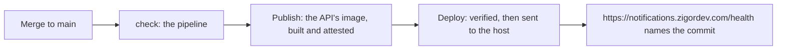

# How notifications reaches production

Every merge to `main` runs the pipeline, publishes the service's image, deploys it to the host, and runs the release of the package of events. This page says what each step does, and what production needed once. toolkit's handbook page [Delivery](https://github.com/zigordev/toolkit/blob/main/docs/handbook/delivery.md) explains every step in depth.

## The path of a merge



| Job     | What it does                                                                                                                                                                                                                      | Runs today |
| ------- | --------------------------------------------------------------------------------------------------------------------------------------------------------------------------------------------------------------------------------- | ---------- |
| check   | toolkit's pipeline: `pnpm check`, the title, the dependencies, the code scan, and the contract on the built image                                                                                                                 | Yes        |
| Publish | Builds `ghcr.io/zigordev/notifications-api` for arm64 under the commit, and records how it was built                                                                                                                              | Yes        |
| Release | Tags the next version from the titles of the merges, and publishes `@zigordev/notifications-events` to npm through its trust in this workflow. A merge whose title gives no version, such as `docs` or `chore`, publishes nothing | Yes        |
| Deploy  | Verifies that record, asks the host through AWS Systems Manager to run the commit, waits for `version` to be the commit from outside, and rolls back when it never is                                                             | Yes        |

The workflows are toolkit's, pinned to one commit of it in `.github/workflows/ci.yml`. Renovate proposes each new version of toolkit.

Once the deploy runs, the host reads `compose.yaml`, `compose.production.yaml` and `.env.production.example` from `main`. It starts PostgreSQL, runs the job `notifications-api-migrate` once, which applies the migrations and sets up pg-boss's queues and schedule, and then replaces the service with docker-rollout, which waits for the new container's health check and drains the old one. During that moment both copies read from Kafka in one consumer group, so each request still reaches one of them, and the outbox of each sends its own outcomes.

## What production needs, once

None of these is in this repo. Each was done once, before the first deploy, by the owner or with the owner's approval of the plan.

| What                                                                                                                                                                                                                            | Who, and when                                                                                                                                      |
| ------------------------------------------------------------------------------------------------------------------------------------------------------------------------------------------------------------------------------- | -------------------------------------------------------------------------------------------------------------------------------------------------- |
| The repo's settings, its ruleset on `main` and its environment `production`, kept as code in `platform/infra/github`                                                                                                            | The platform session. The environment was applied on 2026-11-26, in platform#81                                                                    |
| The deploy target `notifications` in `platform/infra/products.json`, which brings its command, its role and the address                                                                                                         | The platform session, applied on 2026-11-26 in platform#81                                                                                         |
| The repo secret `AWS_ACCOUNT_ID`                                                                                                                                                                                                | The owner, in the repo's settings: Settings, then Secrets and variables, then Actions                                                              |
| `/notifications/POSTGRES_PASSWORD` and `/notifications/NOTIFICATIONS_API_DATABASE_PASSWORD` in AWS Parameter Store, as SecureString                                                                                             | The owner, on 2026-11-26, with the two commands below                                                                                              |
| `/notifications/KAFKA_PASSWORD`: the password of the Kafka user `notifications-api`. The service reads it as `KAFKA_PASSWORD`, and the shared services read the same parameter to make the user, as platform's record 0028 says | The owner, who stored it on 2026-11-25, with the user itself as code in `platform`                                                                 |
| `/notifications/NOTIFICATIONS_API_SMTP_USER` and `/notifications/NOTIFICATIONS_API_SMTP_PASSWORD`: the SES SMTP sign-in of an IAM user that may only send email                                                                 | `platform/infra/email`, which made the IAM user, its key and both values on 2026-11-26, as platform's record 0030 says. Nobody stores them by hand |
| The broker on the host, with the service's user, the topics of each app that sends email, and their access rules                                                                                                                | The platform session, since 2026-11-25                                                                                                             |
| SES out of its sandbox, so that it sends to any address                                                                                                                                                                         | The owner, by a reply to AWS's case. Until then SES sends only to addresses verified in it                                                         |
| The image package made public                                                                                                                                                                                                   | Public since its first publish                                                                                                                     |

The two database passwords are random, and never shown. Each command prints only a version number, and refuses to replace a value that exists:

```bash
aws ssm put-parameter --profile platform-ops --region eu-west-1 --type SecureString --name /notifications/POSTGRES_PASSWORD --value "$(openssl rand -hex 32)"
```

```bash
aws ssm put-parameter --profile platform-ops --region eu-west-1 --type SecureString --name /notifications/NOTIFICATIONS_API_DATABASE_PASSWORD --value "$(openssl rand -hex 32)"
```

In production the service sends through Amazon SES's SMTP endpoint in eu-west-1, `email-smtp.eu-west-1.amazonaws.com`, on port 587 with STARTTLS. `compose.production.yaml` holds those settings, and `.env.production.example` the names of the three secrets the service adds.

## Looking after it

| You want to                       | Do this                                                                                                                                                                                                    |
| --------------------------------- | ---------------------------------------------------------------------------------------------------------------------------------------------------------------------------------------------------------- |
| See what a merge published        | Open the run of the merge on GitHub. Publish names the image and its digest                                                                                                                                |
| Know which version runs           | Open <https://notifications.zigordev.com/health>. `version` is the commit                                                                                                                                  |
| Read the logs, traces and metrics | Grafana Cloud, under the services `notifications-api` and `notifications-api-migrate`                                                                                                                      |
| Know when something is wrong      | Four alerts in `platform` email the owner, each with its runbook. [The alerts that watch it](../README.md#the-alerts-that-watch-it) lists them                                                             |
| Undo a bad version                | Revert its pull request: the revert deploys like any merge                                                                                                                                                 |
| Switch a flag                     | Change it in `apps/notifications-api/flags.json` in a pull request. The image carries the file, so the change goes live with the deploy of that merge                                                      |
| Let a new app send email          | Add it to `apps/notifications-api/producers.json` in a pull request, once `platform` has its Kafka user, its topics and their rules                                                                        |
| Send a dead letter again          | A request the service could not read waits on `notifications.requests.<app>.dead-letter`. Fix the cause, then send its message again to the request topic: the request's id keeps it from being sent twice |
| Run a deploy by hand              | Only with the owner's yes                                                                                                                                                                                  |
