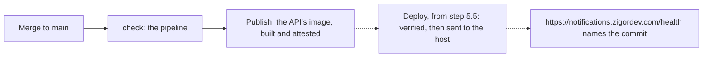

# How notifications reaches production

notifications is not deployed yet. Today every merge to `main` runs the pipeline and publishes the API's image, and the deploy comes with step 5.5 of the Build plan. This page says what runs now, what the deploy adds, and what production needs once. toolkit's handbook page [Delivery](https://github.com/zigordev/toolkit/blob/main/docs/handbook/delivery.md) explains every step in depth.

## The path of a merge

| Job     | What it does                                                                                                                                                          | Runs today |
| ------- | --------------------------------------------------------------------------------------------------------------------------------------------------------------------- | ---------- |
| check   | toolkit's pipeline: `pnpm check`, the title, the dependencies, the code scan, and the contract on the built image                                                     | Yes        |
| Publish | Builds `ghcr.io/zigordev/notifications-api` for arm64 under the commit, and records how it was built                                                                  | Yes        |
| Deploy  | Verifies that record, asks the host through AWS Systems Manager to run the commit, waits for `version` to be the commit from outside, and rolls back when it never is | No         |

The workflows are toolkit's, pinned to one commit of it in `.github/workflows/ci.yml`. Renovate proposes each new version of toolkit.

Once the deploy runs, the host reads `compose.yaml`, `compose.production.yaml` and `.env.production.example` from `main`. It starts PostgreSQL, runs the job `notifications-api-migrate` once, which applies the migrations and sets up pg-boss's queues and schedule, and then replaces the service with docker-rollout, which waits for the new container's health check and drains the old one. During that moment both copies read from Kafka in one consumer group, so each request still reaches one of them, and the outbox of each sends its own outcomes.

## What production needs, once

None of these is in this repo, and none is done yet. The owner approves or does each of them once, before the first deploy.

| What                                                                                                                                                            | Who                                                                               |
| --------------------------------------------------------------------------------------------------------------------------------------------------------------- | --------------------------------------------------------------------------------- |
| The repo's settings, its ruleset on `main` and its environment `production`, kept as code in `platform/infra/github`                                            | The platform session, with the owner's approval of the plan                       |
| The deploy target `notifications` in `platform/infra/products.json`, which brings its command, its role and the address                                         | The platform session, with the owner's approval of the plan                       |
| The repo secret `AWS_ACCOUNT_ID`                                                                                                                                | The owner, in the repo's settings                                                 |
| `/notifications/POSTGRES_PASSWORD` and `/notifications/NOTIFICATIONS_API_DATABASE_PASSWORD` in AWS Parameter Store, as SecureString                             | The owner                                                                         |
| `/notifications/NOTIFICATIONS_API_KAFKA_PASSWORD`: the password of the Kafka user `notifications-api`, which the broker on the host also holds                  | The owner, with the user itself as code in `platform`                             |
| `/notifications/NOTIFICATIONS_API_SMTP_USER` and `/notifications/NOTIFICATIONS_API_SMTP_PASSWORD`: the SES SMTP sign-in of an IAM user that may only send email | The owner, with the IAM user and the SES identity as code in `platform`, step 5.4 |
| The broker on the host, with the service's user, the topics of each app that sends email, and their access rules                                                | The platform session, with the owner's approval of the plan                       |
| SES out of its sandbox, so that it sends to any address                                                                                                         | The owner, by AWS's request form                                                  |
| The image package made public, after the first publish, if GitHub created it as private                                                                         | The owner, in the package's settings                                              |

In production the service sends through Amazon SES's SMTP endpoint in eu-west-1, `email-smtp.eu-west-1.amazonaws.com`, on port 587 with STARTTLS. `compose.production.yaml` holds those settings, and `.env.production.example` the names of the three secrets the service adds.

## Looking after it

| You want to                       | Do this                                                                                                                                                                                                    |
| --------------------------------- | ---------------------------------------------------------------------------------------------------------------------------------------------------------------------------------------------------------- |
| See what a merge published        | Open the run of the merge on GitHub. Publish names the image and its digest                                                                                                                                |
| Know which version runs           | Once deployed, open <https://notifications.zigordev.com/health>. `version` is the commit                                                                                                                   |
| Read the logs, traces and metrics | Once deployed, Grafana Cloud, under the services `notifications-api` and `notifications-api-migrate`                                                                                                       |
| Undo a bad version                | Once deployed, revert its pull request: the revert deploys like any merge                                                                                                                                  |
| Switch a flag                     | Change it in `apps/notifications-api/flags.json` in a pull request. The image carries the file, so the change goes live with the deploy of that merge                                                      |
| Let a new app send email          | Add it to `apps/notifications-api/producers.json` in a pull request, once `platform` has its Kafka user, its topics and their rules                                                                        |
| Send a dead letter again          | A request the service could not read waits on `notifications.requests.<app>.dead-letter`. Fix the cause, then send its message again to the request topic: the request's id keeps it from being sent twice |
| Run a deploy by hand              | Only with the owner's yes                                                                                                                                                                                  |
