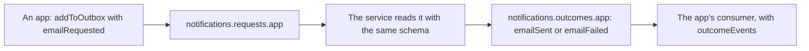

# @zigordev/notifications-events

The events of the notifications service: the request an app sends to have an email delivered, the two outcomes the service sends back, and the names of the Kafka topics they travel on. The service and every app that sends email use this one package, so they always agree on what a request holds.

## What it is

| Export                                       | What it is                                                                                            |
| -------------------------------------------- | ----------------------------------------------------------------------------------------------------- |
| `emailRequested`                             | The event `email.requested`, version 1: the email to deliver, for `addToOutbox` of `@zigordev/events` |
| `emailSent`, `emailFailed`                   | The events `email.sent` and `email.failed`, version 1: what happened to a request                     |
| `outcomeEvents`                              | Both outcomes, for the `events` of an app's consumer                                                  |
| `requestTopicOf(app)`, `outcomeTopicOf(app)` | The topics of an app: `notifications.requests.<app>` and `notifications.outcomes.<app>`               |
| `emailRequestSchema`, `mailboxSchema`        | The Zod schemas of a request and of an address, for a check before the request is built               |
| `failureReasons`                             | Why an email can fail: `rejected`, `attempts_exhausted`, `retry_limit_reached` and `sender_forbidden` |
| `maxRequestBytes`                            | 800,000: the largest request, as JSON                                                                 |
| `EmailRequest`, `EmailOutcomeEvent`, …       | The types of the data and of the events                                                               |

The package also ships `events.json`: the contract of the three events as JSON Schema, with the names of their topics, for a reader that is not written in TypeScript.

An event is defined with `defineEvent` of [`@zigordev/events`](https://github.com/zigordev/toolkit/blob/main/packages/events/README.md): a name, a version and a Zod schema, written once and used by the sender and the reader.

## Why we have it

Without one shared package, each app would describe the request in its own code, and the first field that one of them misspells would only show when the service set the message aside. With it, a request that breaks a rule fails in the app's own `addToOutbox`, inside its own transaction, before anything is saved. toolkit's [record 0042](https://github.com/zigordev/toolkit/blob/main/docs/adr/0042-notifications-takes-requests-and-gives-outcomes-over-kafka.md) put the schemas in a package published from this repo, and the repo's [record 0002](../../docs/adr/0002-requests-and-outcomes-travel-on-topics-named-after-the-service.md) holds the topics and the fields.

## How it works here



- **The request is strict.** An unknown field, a missing body, a subject with a line break, more than 10 tags, or a request over 800,000 bytes fails at once. Kafka's default limit for one message is 1,048,588 bytes.
- **The outcomes are lenient.** A reader on version 1 lets an unknown field through, so the service can add a field to an outcome without breaking any app. A field that changes or goes gets a new version.
- **The request's id is its key.** `addToOutbox` gives each request a random id. The service accepts a request once, however often Kafka brings it, and its outcome names that id.
- **The topics carry the sender.** Only the app may write its request topic, as `platform`'s access rules say, so the service knows the producer from the topic.
- **The contract is committed.** `events.json` holds each event's type, version and JSON Schema. A test fails while it differs from the code, so a change to an event shows in review as a change of the contract. Another test keeps reading requests and outcomes that version 1 allowed, so tightening a rule of version 1 fails too.
- **It is published by the pipeline.** On a merge to `main`, the Release job of toolkit tags the next version and publishes the package to npm, through npm's trust in GitHub's proof of the workflow, with no stored token. The service's app is never published. toolkit's [packages page](https://github.com/zigordev/toolkit/blob/main/docs/handbook/packages.md) explains the release.

## How to use it

Install it beside `@zigordev/events`:

```bash
pnpm add @zigordev/notifications-events @zigordev/events zod
```

Send a request in the transaction of the change it belongs to, and keep its id:

```ts
import { addToOutbox } from '@zigordev/events';
import { emailRequested, requestTopicOf } from '@zigordev/notifications-events';

const request = await addToOutbox(tx, {
  topic: requestTopicOf('playground-api'),
  event: emailRequested,
  data: {
    to: { email: 'ana@example.com', name: 'Ana' },
    subject: 'Confirm your email address',
    html: '<p>…</p>',
    text: '…',
    tags: { template: 'verify-email', locale: 'en' },
  },
});
```

Read the outcomes with a consumer of the app's own:

```ts
import { defineConsumer } from '@zigordev/events';
import { outcomeEvents, outcomeTopicOf } from '@zigordev/notifications-events';

defineConsumer({
  group: 'playground-api.email-outcomes',
  topics: [outcomeTopicOf('playground-api')],
  events: outcomeEvents,
  handle: async (event, { tx }) => {
    if (event.type === 'email.failed') {
      await markVerificationFailed(tx, event.data.requestId, event.data.reason);
    }
  },
});
```

The repo's [user manual](../../docs/user-manual.md) lists every field, every reason and what an app needs before its first email.

## How to check that it works

- `pnpm exec vitest run --project notifications-events` runs the package's own tests: every rule of the request, the outcomes, the topic names, a request read back through the envelope of `@zigordev/events`, and the committed contract.
- After a change to an event, `pnpm --dir packages/notifications-events run contract` writes `events.json` again. Read the difference before committing it: a change that a reader of the same version would not understand needs a new version of the event instead.
- The service's tests send real requests built with this package through a real Kafka, and read the outcomes with it, so the package and the service cannot drift apart.

| What you see                                                     | What it means, and what to do                                                                                  |
| ---------------------------------------------------------------- | -------------------------------------------------------------------------------------------------------------- |
| `addToOutbox` throws a `ZodError`                                | The request breaks a rule. The error's issues name each field                                                  |
| `An app is named in lower case words joined by dashes`           | `requestTopicOf` was given a name that is not an app's Kafka user                                              |
| No outcome comes, and the service logs `events.message_rejected` | The service could not read the request: the app sends an event or a version that the service does not know yet |
| An outcome `email.failed` with `sender_forbidden`                | The request's `from` is not among the app's senders in the service's `producers.json`                          |
| The contract test fails                                          | An event changed. Write `events.json` again, and check that the change keeps version 1 readable                |
